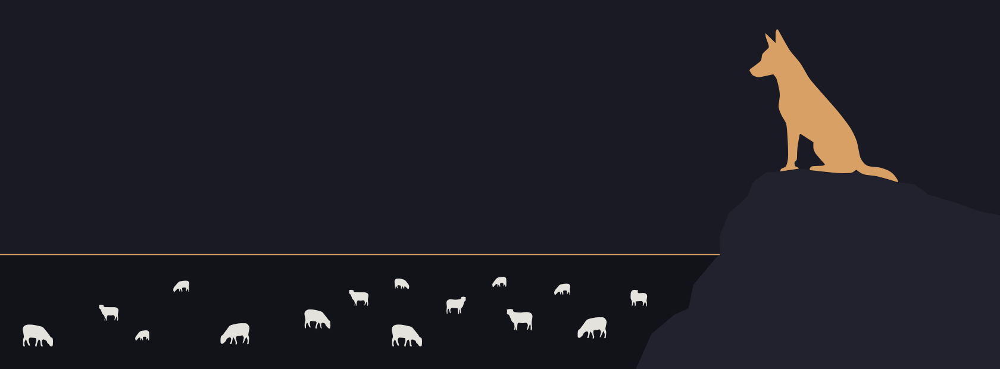

<p align="center">
  <picture>
    <source media="(prefers-color-scheme: dark)" srcset="assets/brand/kelpie-lockup-horizontal-dark.svg" />
    
  </picture>
</p>

<p align="center"><b>Many agents. One calm shepherd's dog.</b></p>

<p align="center">
  <a href="#why-kelpie">Why Kelpie</a> · <a href="#install">Install</a> · <a href="#what-it-does">What it does</a> · <a href="#development">Development</a> · <a href="#credits">Credits</a>
</p>

<p align="center">
  <a href="LICENSE"></a>
  
  
</p>

<p align="center">
  
</p>

---

Kelpie is a terminal multiplexer and runtime for AI coding agents such as Claude Code, Codex and Cursor. Run ten or more sessions side by side, each with its own native terminal UI, backed by a server-owned runtime with a local JSON API. A supervisor agent can watch every session and nudge it forward. The human always wins. First-class on Windows 11 and PowerShell 7, and at home on Linux and macOS.

## Why Kelpie

herdr is one of the few tools that genuinely moved me. The first time I used it, I loved it so much I shed a tear. The more I lived in it, though, the more its small rough edges wore on me, and herdr only accepts pull requests from approved contributors, so I couldn't send fixes back. So I forked it. Kelpie is herdr with those edges sanded down, and a supervisor on top.

## What it does

- **Detach without stopping work.** Terminals keep running in a background server when you close the client or lose your SSH connection. After a restart, Kelpie restores the saved layout and can resume supported agent sessions.
- **Every agent in view.** Each pane is marked working, waiting, idle or done. The sidebar shows how long a pane has been idle, flags stale workspaces and marks the one waiting for you with `!!`.
- **A supervisor that asks before it types.** `kelpie agent watch` streams a bounded view of every agent. `kelpie agent submit`, `answer`, `interrupt`, `reset` and `resume` write only into a clean input box, are fenced against your own keystrokes, and leave a receipt you can check with `kelpie agent submit-status`. Hand a pane to the supervisor once, for 30m/2h/8h or permanently with `ctrl+b shift+a`; it shows a violet `◈ bot` badge and you can take it back any time.
- **Agent profiles.** Claude Code, Codex and Cursor are built in: input box shape, placeholder style, submit, interrupt and clear keys. Claude Code also confirms delivery through its prompt hook.
- **Runs what you already run.** Claude Code, Codex, Cursor, OpenCode, Grok and more. Kelpie does not wrap or replace them; it owns their terminals.
- **Keyboard and mouse, both first-class.** tmux-style prefix keys (`ctrl+b`) and click, drag, split.
- **Calm themes for long sessions.** `midnight`, `dusk`, `ember`, `slate`, `forest` and `kelpie`, with a live picker on `ctrl+b t`.
- **Host facts.** `ctrl+b i` shows the machine, shell, GPU, Docker, WSL and the command-line tools agents can use.
- **One Rust binary, no Electron.** Runs in whatever terminal you already use.

## Install

Download the latest release for your platform from [kelpie.multicastbits.com](https://kelpie.multicastbits.com) or [GitHub Releases](https://github.com/malindarathnayake/kelpie/releases/latest), unpack it, and run the installer inside:

```powershell
# Windows x64, in the unzipped folder
powershell -ExecutionPolicy Bypass -File .\install.ps1 -Integrations claude,codex,cursor
```

```sh
# Mac (Apple Silicon), in the extracted folder
sh install.sh claude codex cursor
```

Then open a new terminal and run `kelpie`. Self-update is off for now; to update, install the newer release the same way.

### Build from source

Requirements: Rust (the version in `rust-toolchain.toml`) and Zig 0.16.0.

```powershell
git clone https://github.com/malindarathnayake/kelpie
cd kelpie
cargo build --release
.\target\release\kelpie.exe
```

On Linux and macOS the binary is `./target/release/kelpie`.

Kelpie keeps its own config, state and socket, so it runs side by side with an installed herdr without touching it.

Run your agents, split panes, walk away. `ctrl+b q` detaches and `kelpie` reattaches.

## Development

```bash
just test        # unit tests
just check       # formatting, tests and maintenance checks
```

If you are an AI agent working in this repository, read [`AGENTS.md`](./AGENTS.md) before making changes and [`CONTRIBUTING.md`](./CONTRIBUTING.md) before opening issues or PRs.

## Credits

Kelpie is a community fork built on [herdr](https://github.com/herdrdev/herdr) by Ogulcan Celik and its contributors. The runtime, the terminal engine, the agent detection and most of what makes Kelpie work started there. Thank you.

## License

Kelpie is licensed under the [Apache License 2.0](LICENSE), the same license as herdr.
